# Cartly — Application Flow Document

**Version:** 1.0  
**Status:** Approved for planning  
**Last updated:** 2026-11-21  
**Related documents:** `PRD.md`, `TRD.md`, `UI-UX-BRIEF.md`, `BACKEND-SCHEMA.md`

---

## 1. Purpose

This document defines **complete user navigation**: every route, which role may enter it, where users are redirected, what happens on success and failure, and how state changes as they move. It translates the features and BR-01 … BR-20 rules of `PRD.md` into observable behaviour and uses the API contract in `TRD.md`.

---

## 2. Features covered

| ID | Flow | Primary role |
|---|---|---|
| FL-01 | Guest discovery (browse, search, filter, detail) | Guest |
| FL-02 | Registration and login with return-to-intent | Guest → Customer |
| FL-03 | Add-to-cart authentication gate | Guest → Customer |
| FL-04 | Cart management and live estimate | Customer |
| FL-05 | Checkout and mock payment | Customer |
| FL-06 | Confirmation, history, and order detail | Customer |
| FL-07 | Customer cancellation | Customer |
| FL-08 | Admin sign-in and back-office entry | Admin |
| FL-09 | Product management | Admin |
| FL-10 | Category management | Admin |
| FL-11 | Shipping and tax settings | Admin |
| FL-12 | Order processing | Admin |
| FL-13 | Session expiry and refresh | All authenticated |
| FL-14 | Error and edge-case flows | All |

---

## 3. User roles and route matrix

### 3.1 Detailed requirements

- Every route is protected by the guard shown in the matrix; UI hiding is never the only control.
- The router stores intended paths and restores them after login (return-to-intent).
- All state-changing actions call the API in `TRD.md`; the client does not invent totals, stock, or statuses.
- Error, empty, and loading states are part of every flow; no screen dead-ends without a next action.
- Order status changes follow the state machine in section 16 only; no direct status edits.

| Route | Guest | Customer | Admin | Guard behaviour |
|---|---|---|---|---|
| `/` | Yes | Yes | Yes | Public home |
| `/products` | Yes | Yes | Yes | Public listing |
| `/products/:slug` | Yes | Yes | Yes | Public detail |
| `/login`, `/register` | Yes | Redirect `/` | Redirect `/admin` | Authenticated users cannot see auth pages |
| `/cart` | → `/login?redirect=/cart` | Yes | → `/admin` | `requireAuth` + `requireCustomer` |
| `/checkout` | → `/login?redirect=/checkout` | Yes (non-empty cart) | → `/admin` | `requireAuth` + non-empty cart |
| `/order-confirmation/:id` | → `/login` | Yes (owner only) | → `/admin` | Ownership check |
| `/orders` | → `/login` | Yes | → `/admin` | `requireAuth` |
| `/orders/:id` | → `/login` | Yes (owner only) | → `/admin` | Ownership check |
| `/forbidden` | Yes | Yes | Yes | 403 explanation page |
| `/admin` | → `/login?redirect=/admin` | → `/forbidden` | Yes | `requireAdmin` |
| `/admin/products` | → `/login` | → `/forbidden` | Yes | `requireAdmin` |
| `/admin/products/new` | → `/login` | → `/forbidden` | Yes | `requireAdmin` |
| `/admin/products/:id/edit` | → `/login` | → `/forbidden` | Yes | `requireAdmin` |
| `/admin/categories` | → `/login` | → `/forbidden` | Yes | `requireAdmin` |
| `/admin/categories/new` | → `/login` | → `/forbidden` | Yes | `requireAdmin` |
| `/admin/categories/:id/edit` | → `/login` | → `/forbidden` | Yes | `requireAdmin` |
| `/admin/settings/shipping` | → `/login` | → `/forbidden` | Yes | `requireAdmin` |
| `/admin/settings/tax` | → `/login` | → `/forbidden` | Yes | `requireAdmin` |
| `/admin/orders` | → `/login` | → `/forbidden` | Yes | `requireAdmin` |
| `/admin/orders/:id` | → `/login` | → `/forbidden` | Yes | `requireAdmin` |
| `*` (unknown) | Not found page | Not found page | Not found page | 404 |

**Redirect contract:** when an unauthenticated user hits a protected route, the router stores the intended path in `sessionStorage` and appends `?redirect=<path>` to `/login`. After successful login, the user is returned to that path. If the intended path was `/login` or `/register`, the user lands on `/` (customer) or `/admin` (admin). Authenticated admins may open public catalog routes, but purchase controls are hidden.

---

## 4. High-level role flow

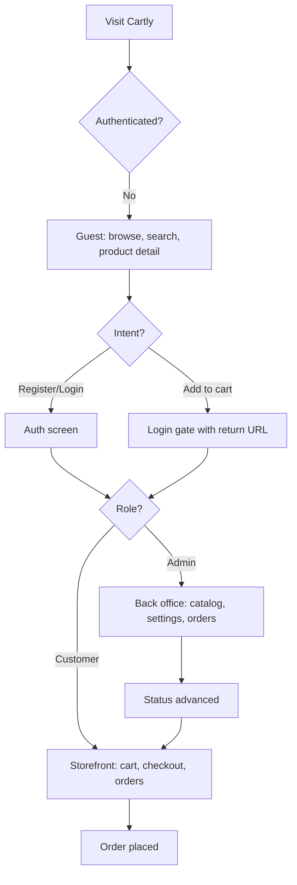

---

## 5. FL-01 — Guest discovery

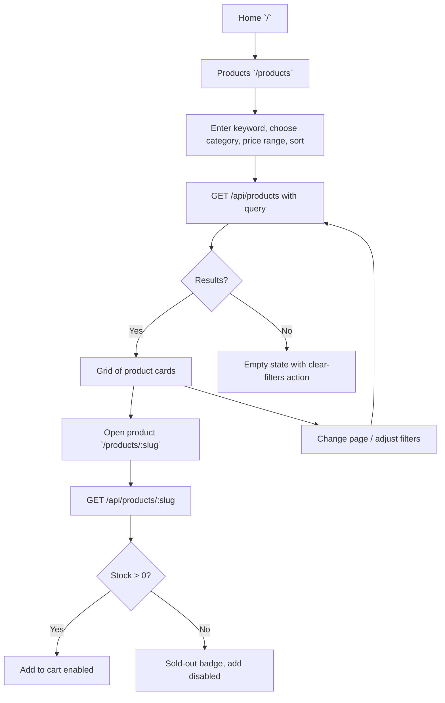

**Rules applied:** BR-01 (only active, non-deleted products), BR-03 (server-side search/filters/pagination), BR-19 (USD/English).

**Outputs:** populated listing, stable filter state in URL query string, product detail with correct availability.

---

## 6. FL-02 — Registration and login with return-to-intent

```mermaid
flowchart TD
    A[Protected route or auth link] --> B[/login or /register]
    B --> C{Submit valid?}
    C -- No --> D[Inline field errors, stay on screen]
    C -- Yes --> E[POST /api/auth/register or /login]
    E --> F{Success?}
    F -- No, 401 --> G[Generic invalid-credentials message]
    F -- No, 409 --> H[Email already registered link to login]
    F -- Yes --> I[Store access token in memory, refresh cookie set]
    I --> J{Role}
    J -- Customer --> K[Redirect to stored path or `/`]
    J -- Admin --> L[Redirect to stored path or `/admin`]
```

**Rules applied:** BR-15 (no public admin registration; role field ignored), BR-16 (token lifetime and rotation).

**Outputs:** authenticated session, correct landing page, preserved intended destination.

---

## 7. FL-03 — Add-to-cart authentication gate

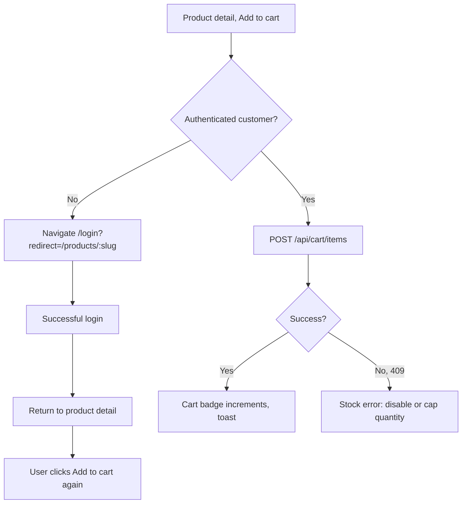

**Rules applied:** BR-04 (auth required), BR-05 (quantity/stock), BR-06 (stock correctness). Note: the item is **not** auto-added after login; the user confirms with a second click so intent is explicit. Authenticated admins see no Add to cart control on public product pages.

**Outputs:** cart updated and header badge refreshed, or a clear stock/auth message.

---

## 8. FL-04 — Cart management and live estimate

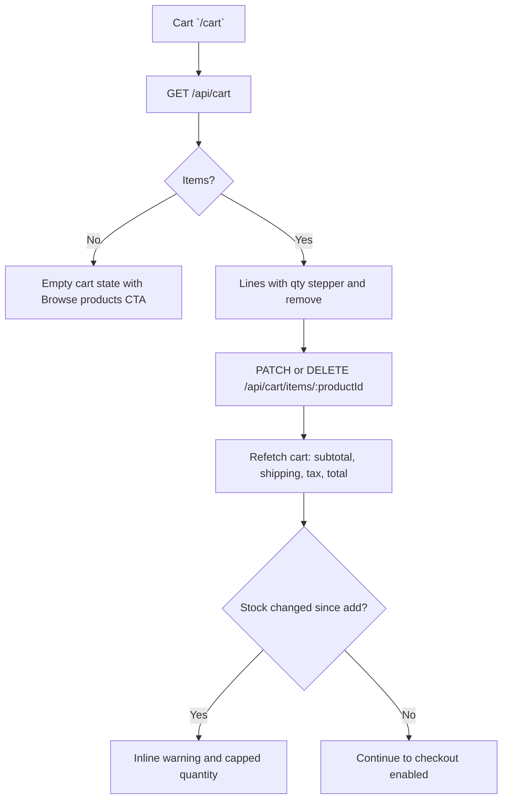

**Rules applied:** BR-02, BR-04, BR-05, BR-08, BR-09, BR-10, BR-19.

**Outputs:** accurate line totals and order estimate; blocked checkout if any line is unavailable.

---

## 9. FL-05 — Checkout and mock payment

```mermaid
sequenceDiagram
    participant U as Customer
    participant W as React client
    participant A as Express API
    participant D as PostgreSQL

    U->>W: Open /checkout, enter address
    W->>W: Generate idempotency key
    U->>W: Place order
    W->>A: POST /api/orders (address, customer-scoped idempotency key)
    A->>D: Begin transaction
    A->>D: Lock product rows, re-check stock and active flags
    alt Item unavailable
        A-->>W: 409 OUT_OF_STOCK / PRODUCT_UNAVAILABLE
        W-->>U: Error and link back to cart; cart unchanged
    else All items available
        A->>D: Read current shipping/tax settings
        A->>D: Insert Order (PENDING_PAYMENT, internal only) + OrderItem snapshots
        A->>D: Mock capture: set PAID + SYSTEM OrderEvent
        A->>D: Decrement stock, clear cart, store idempotency key
        A-->>W: 201 { orderId, orderNumber, totalCents }
        W-->>U: Navigate /order-confirmation/:id
    end
```

**Rules applied:** BR-02, BR-06, BR-07, BR-08, BR-09, BR-10, BR-13, BR-17, BR-18.

**Outputs:** one order, correct snapshots and totals, stock decremented, cart emptied, confirmation screen. Duplicate submission with the same key returns the original order.

---

## 10. FL-06 — Confirmation, history, and detail

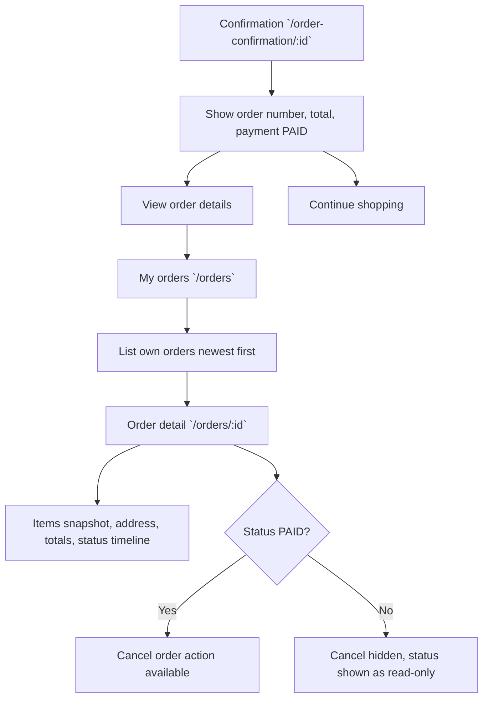

**Rules applied:** BR-11, BR-13, BR-16.

**Outputs:** customer can confirm purchase and track status; no access to other customers' orders.

---

## 11. FL-07 — Customer cancellation

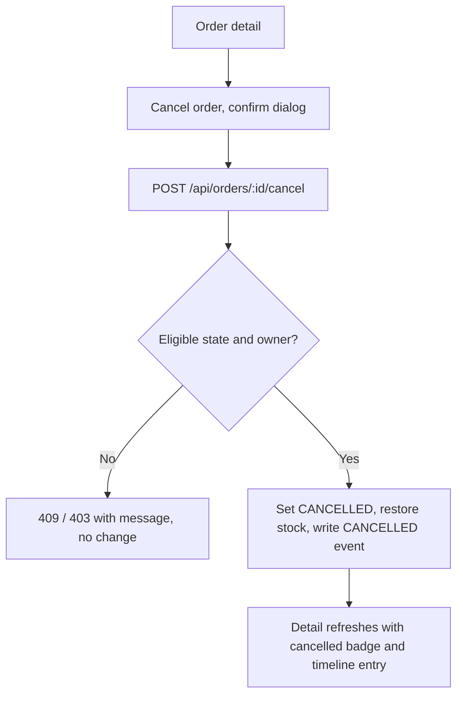

**Rules applied:** BR-11 (cancellation from `PAID` only), BR-12, BR-13.

**Outputs:** stock restored exactly once, audited status change, read-only cancelled order.

---

## 12. FL-08 — Admin sign-in and back-office entry

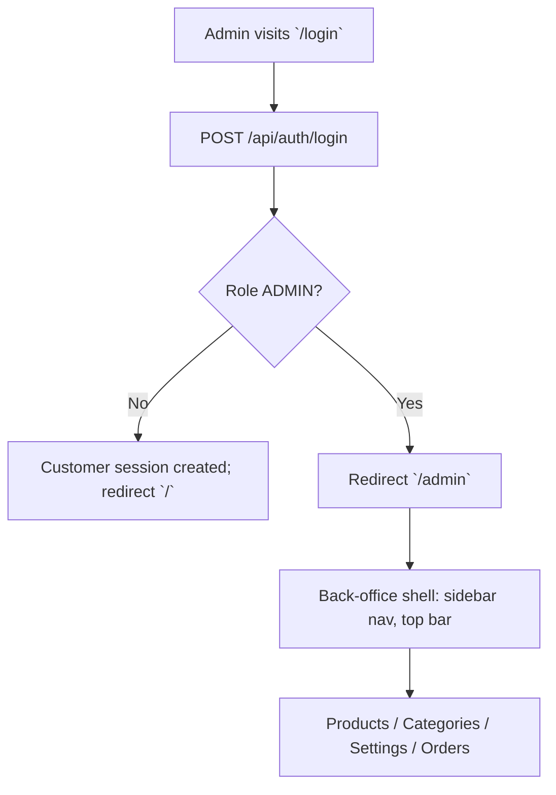

**Rules applied:** BR-15, BR-16. Admin accounts exist only via seed; public registration always creates a customer.

**Outputs:** admin shell with only back-office navigation; customer routes refused with 403.

---

## 13. FL-09 — Product management

```mermaid
flowchart TD
    A[Admin products list] --> B{Action}
    B -- Create --> C[Product form: name, slug, description, price, stock, sku, image URLs, category, active]
    B -- Edit --> D[Load product into same form]
    B -- Delete --> E[Confirm soft delete]
    C --> F[POST /api/products]
    D --> G[PATCH /api/products/:id]
    E --> H[DELETE /api/products/:id]
    F --> I[Validate: unique slug/sku, http(s) image URLs, cents and stock integers]
    G --> I
    I --> J{Success?}
    J -- Yes --> K[List refreshes, toast]
    J -- No, validation --> L[Inline errors, stay on form]
    H --> M[Product marked deletedAt, hidden from public catalog]
```

**Rules applied:** BR-01, BR-14, BR-17. Old orders keep their item snapshots (BR-13).

**Outputs:** catalog reflects admin changes; deleted products remain in historical orders.

---

## 14. FL-10 — Category management

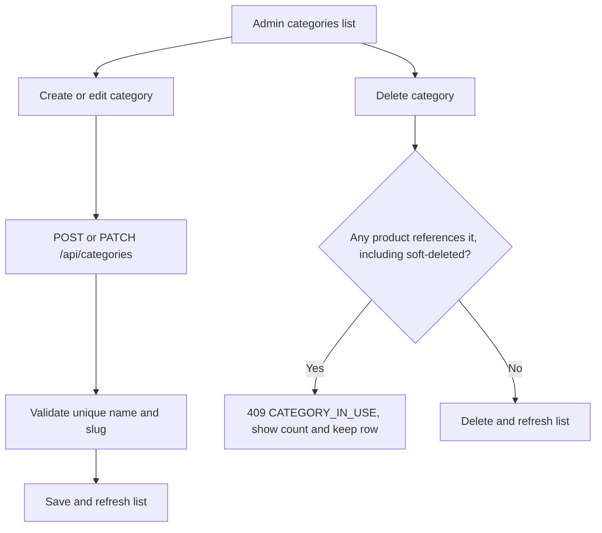

**Rules applied:** BR-14.

**Outputs:** category list accurate; destructive delete never breaks product references.

---

## 15. FL-11 — Shipping and tax settings

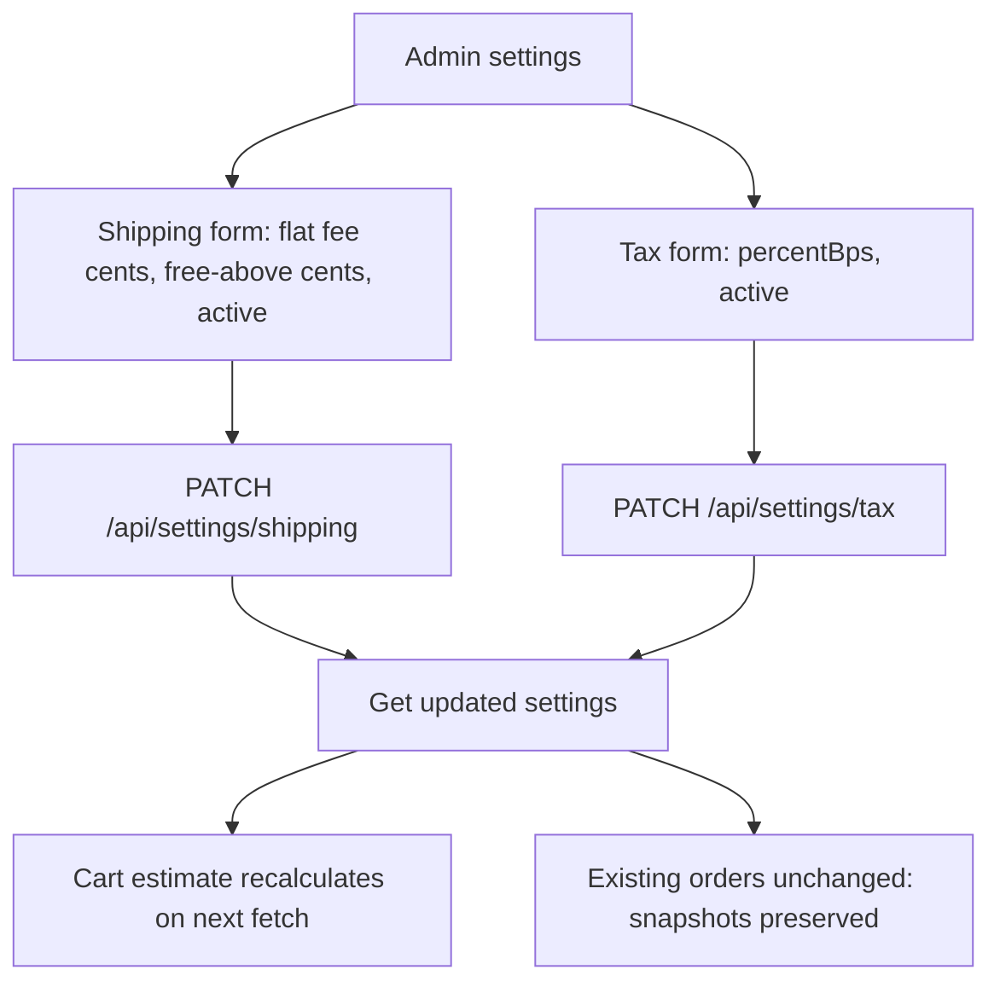

**Rules applied:** BR-08, BR-09, BR-10, BR-13, BR-17.

**Outputs:** new estimates for future carts/orders; historical order totals immutable.

---

## 16. FL-12 — Admin order processing

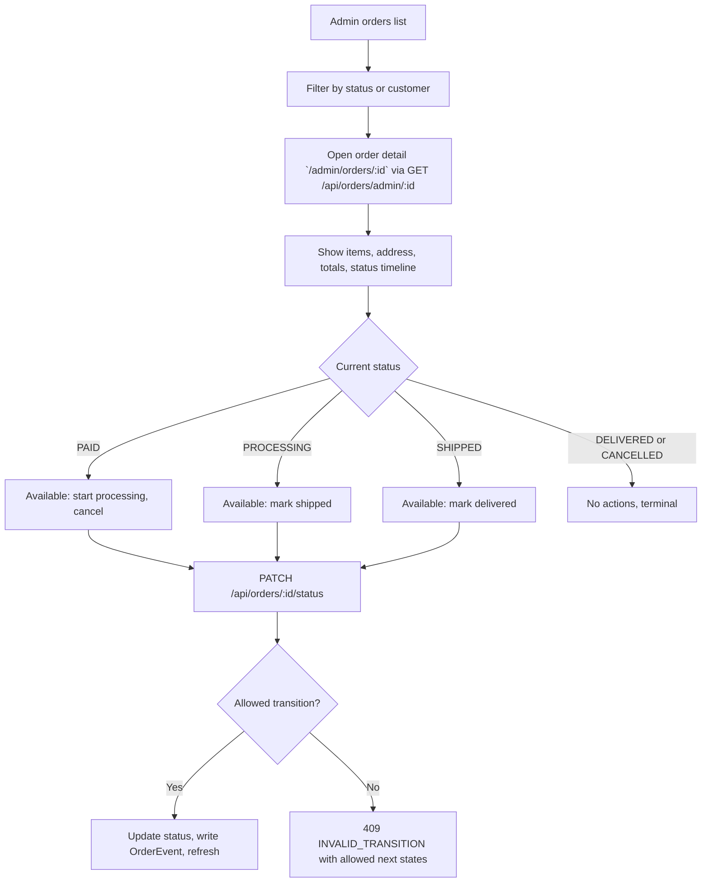

**Rules applied:** BR-11, BR-12, BR-13.

**Outputs:** orders progress through a controlled lifecycle; every change is audited and visible to the customer in their order detail.

### Order status state machine

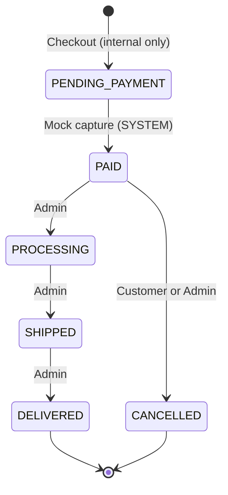

---

## 17. FL-13 — Session expiry and refresh

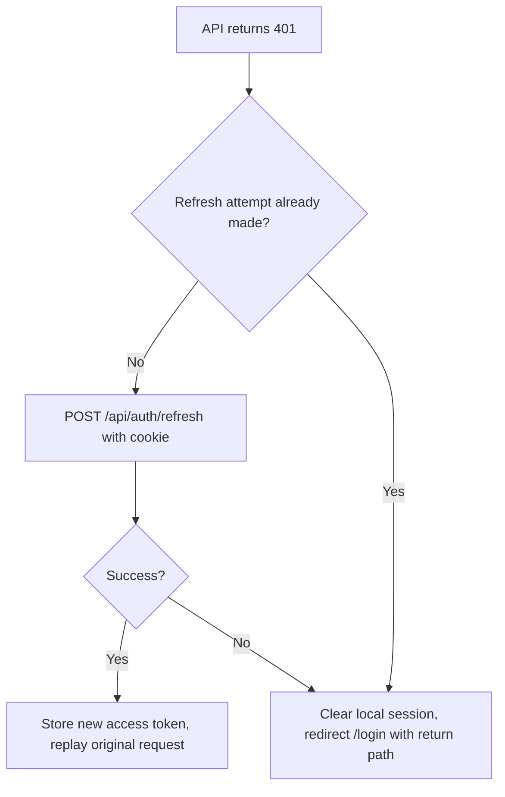

**Rules applied:** BR-16. The refresh cookie rotates on every use; reuse of an old token revokes the session family.

**Outputs:** seamless session continuation or a clean re-login without losing the intended destination.

---

## 18. FL-14 — Error and edge-case flows

| Situation | Trigger | System behaviour | User-facing result |
|---|---|---|---|
| Empty search results | No FTS matches | 200 with empty items | Empty state + clear filters |
| Out-of-stock product | `stock = 0` | Public detail still visible | Sold-out badge, add disabled (BR-01, BR-06) |
| Quantity above stock | Stepper exceeds stock | 409 from cart/checkout | Inline message, quantity capped (BR-05) |
| Empty cart checkout | Direct URL visit | Guard blocks route | Redirect to `/cart` with notice |
| Checkout stock conflict | Another buyer bought last unit | 409, transaction rolled back | "Item no longer available", cart preserved |
| Duplicate checkout | Double click / retry | Idempotency key matched | Same order returned, no duplicate (BR-18) |
| Invalid status transition | Admin clicks stale action | 409 with allowed states | Banner, list refreshes |
| Category in use | Delete referenced category | 409 CATEGORY_IN_USE | Message with product count |
| Session expired | 401 | Refresh then re-login if invalid | Transparent refresh or login redirect |
| Wrong role | Customer visits `/admin/*` | 403 | `/forbidden` page |
| Soft-deleted product in old order | Product deleted after purchase | Snapshot displayed | Full historical detail intact (BR-13, BR-14) |
| Network failure | Request rejected | Error boundary / toast | Retry action, no silent failure |

---

## 19. Business rules referenced by flows

| Flow | Rules |
|---|---|
| FL-01 | BR-01, BR-03, BR-19 |
| FL-02 | BR-15, BR-16 |
| FL-03 | BR-04, BR-05, BR-06 |
| FL-04 | BR-02, BR-04, BR-05, BR-08, BR-09, BR-10 |
| FL-05 | BR-02, BR-06, BR-07, BR-08, BR-09, BR-10, BR-13, BR-17, BR-18 |
| FL-06 | BR-11, BR-13, BR-16 |
| FL-07 | BR-11, BR-12, BR-13 |
| FL-08 | BR-15, BR-16 |
| FL-09 | BR-01, BR-14, BR-17 |
| FL-10 | BR-14 |
| FL-11 | BR-08, BR-09, BR-10, BR-13, BR-17 |
| FL-12 | BR-11, BR-12, BR-13 |
| FL-13 | BR-16 |
| FL-14 | BR-01, BR-04, BR-05, BR-06, BR-13, BR-14, BR-18 |

---

## 20. Expected output

This document produces:

1. A 23-route navigation matrix with role permissions and redirect rules.
2. Fourteen documented flows, including Mermaid diagrams for discovery, authentication, cart, checkout sequence, cancellation, admin operations, session refresh, and the order state machine.
3. A defined redirect contract preserving user intent after login.
4. A complete edge-case table with system behaviour and user-facing result.
5. Explicit traceability from every flow to BR-01 … BR-20 and therefore to the PRD, TRD, UI brief, and schema.

**No implementation code is produced by this document.**
